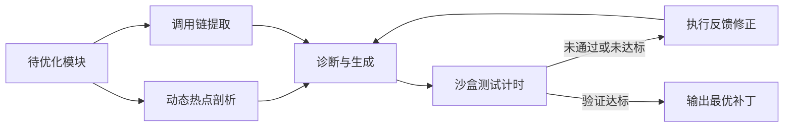

# 软件优化智能体设计（2026 秋季图灵班科研轮转 · 第一周）

本仓库是北京大学熊英飞老师课题组 2026 年秋季图灵班统一科研轮转计划中**第一周“软件优化智能体设计”**（负责人：赵雨薇，`zhaoyuwei@stu.pku.edu.cn`）的配套实践仓库，同时提供**第六周自选拓展方向**的进阶课题指南。

遇到环境配置、接口额度或实验设计问题时，欢迎随时通过微信或邮件联系负责人，也鼓励大家善用编程智能体辅助排查问题。

## 一、轮转目标与任务划分（必做与拓展）

本年度轮转每轮共 6 周，前五周依次接触课题组五个核心方向，第六周由同学自选一个感兴趣的方向深入拓展。围绕软件性能优化这一主题，我们将内容明确划分为**第一周必做任务**与**第六周可选拓展**：

| 阶段 | 模块 | 核心内容与交付要求 | 预计耗时 |
| --- | --- | --- | --- |
| **第一周（必做）** | 1. 工具与接口准备 | 配置编程智能体（推荐北大版 Qoder 或每日免费积分工具）与大模型 API，跑通基础调用与工具循环示例 | 0.5–1 小时 |
| **第一周（必做）** | 2. 文献脉络与精读 | 了解自动代码优化四阶段演进脉络，从推荐清单中**精读 1–2 篇代表性论文** | 3–4 小时 |
| **第一周（必做）** | 3. 优化智能体小练习 | 在本仓库轻量可执行基准 `PyOpt-Lite`（8 道多函数任务）上，对比单轮基线与接入**热点剖析、调用链分析、多轮执行反馈**后的智能体指标表现 | 2–3 小时 |
| **第二周初（必做）** | 4. 10 分钟 PPT 汇报 | 制作 PPT 进行 10 分钟汇报，涵盖论文核心洞察、智能体机制消融结果与典型案例归因 | — |
| **第六周（可选拓展）** | 5. 进阶方向自选探索 | 若第六周选择本方向，可从 **GSO 真实大型仓库评测**、**SemOpt 结构化策略库/RAG**、**RSI 自进化优化智能体** 三个课题中任选其一深入研究 | 1 周 |

## 二、仓库目录导航

```text
26fall-rotation_project/
├── config_template.py               # 大模型 API 配置模板（支持课题组门户、DeepSeek、百炼等）
├── requirements.txt                 # 依赖清单（仅需 openai>=1.40.0，评测器仅依赖 Python 标准库）
├── docs/
│   ├── 01_api_and_agent_guide.md    # API 获取、免费编程智能体（北大 Qoder 等）与提示工程精要
│   ├── 02_literature_roadmap.md     # 代码优化领域四阶段演进全景与第一周必读/选读论文清单
│   └── 03_week6_extensions.md       # 第六周自选方向拓展指南（GSO / SemOpt 策略库 / RSI 自进化）
├── part1_basics/
│   ├── 01_hello_api.py              # 最小 API 调用与前缀缓存命中统计示例
│   └── 02_structured_and_tools.py   # 不到 100 行代码演示编程智能体的工具调用循环
├── benchmark/                       # PyOpt-Lite：8 道标准库 Python 多函数性能基准任务
│   ├── tasks.json                   # 任务元数据、入口函数与瓶颈机制说明
│   ├── tasks/                       # 各任务的待优化源码 target.py、工作负载 workload.py 与单元测试
│   └── reference_patches/           # 供独立评测器计算专家水平达成率的参考优化实现（实验时勿喂给模型）
└── agent_lab/                       # 第一周优化智能体实验工作台
    ├── profiler_tools.py            # cProfile 动态热点排行与 AST 静态上下游调用链提取工具
    ├── baseline_direct.py           # 单轮 Direct Prompt 基线脚本
    ├── agent_starter.py             # 模块化优化智能体脚手架（支持剖析、调用链与有界多轮反馈）
    └── evaluate.py                  # 统一评测脚本（输出 Pass@1、GeoMean 加速比、Opt@1.2x、Opt_Ref）
```

## 三、快速开始：API、智能体与文献阅读

### 1. 配置编程智能体与 API

详细渠道对比、避坑说明与提示工程准则请阅读 **[docs/01_api_and_agent_guide.md](docs/01_api_and_agent_guide.md)**。核心要点如下：

- **编程智能体（推荐优先免费获取）**：首选**北京大学正版授权 Qoder**（登录[北京大学校内信息门户](https://portal.pku.edu.cn/)搜索 `Qoder` 即可免费申领每月 3,000 Credits，细则见[计算中心通知](https://cc.pku.edu.cn/notice/859.html)）；也可搭配使用每日签到赠送积分的腾讯 **WorkBuddy**（内置混元 `Hy4` 免费/优惠档）、阿里**千问办公**或**豆包工作**桌面端。
- **脚本实验 API**：可联系负责人开通[课题组大模型门户](https://llm.xmcp.ltd/)额度，或在 [DeepSeek 开放平台](https://platform.deepseek.com/) 充值 10 元人民币（运行完第一周全部对比实验通常仅消耗约 0.5–2 元）；进阶实验也可尝试折扣期单价接近 DeepSeek 且综合表现突出的阿里云百炼 `qwen4-max-preview`、腾讯混元 `Hy4` 或 Google `Gemini 4` 系列（个人避免直接注册充值 Claude，以免触发账号封禁，确有需求请通过课题组门户调用）。

```bash
git clone https://github.com/fyrsta7/26fall-rotation_project.git
cd 26fall-rotation_project
pip install -r requirements.txt
cp config_template.py config.py   # 填入你的 API_KEY、BASE_URL 与 MODEL
python3 part1_basics/01_hello_api.py
python3 part1_basics/02_structured_and_tools.py
```

### 2. 梳理领域脉络与精读 1–2 篇论文

阅读 **[docs/02_literature_roadmap.md](docs/02_literature_roadmap.md)**，把握代码优化从“编译器手工规则 → 单函数进化搜索（如 [SBLLM](https://arxiv.org/abs/2408.12159)）→ 真实仓库策略引导与跨函数优化（如 [SemOpt](https://arxiv.org/abs/2510.16384)、[PEACE](https://arxiv.org/abs/2510.17142)、[GSO](https://arxiv.org/abs/2505.23671)）→ 长程自进化智能体（如 [GEPA](https://arxiv.org/abs/2507.19457)、[Darwin Gödel Machine](https://arxiv.org/abs/2505.22954)、[Hyperagents](https://arxiv.org/abs/2603.19461)）”的完整发展历程。请从文档末尾的推荐组合中挑选 **1–2 篇论文**完成精读（例如经典的 `SBLLM` 搭配新近仓库级工作 `PEACE` / `GSO` / `SemOpt`）。

## 四、第一周必做小练习：设计并评测可解释的代码优化智能体

### 1. 基准设计与任务构成（PyOpt-Lite）

真实仓库基准（如 GSO）的全量容器评测需要下载上百 GB 镜像并经历较长的编译等待，而静态代码片段数据集无法执行性能计时与动态剖析。为此，本仓库提供了由 **8 道标准库 Python 多函数性能任务**组成的轻量可执行基准 **`PyOpt-Lite`**：免安装容器与第三方编译依赖，全量评测耗时约 12 秒，同时覆盖跨函数调用冗余、可变状态缓存失效、数据结构替换与边界异常契约四类典型工程问题。

| 任务 ID | 场景主题 | 核心性能反模式与智能体诊断看点 | 参考补丁加速比 |
| --- | --- | --- | ---: |
| `task_01_log_router` | 日志分级路由匹配 | 叶子匹配函数耗时占比突出，根因是上游批量循环重复解析规则文本与编译正则 | ~8.8x |
| `task_02_graph_reach` | 依赖图传递可达性 | 批量查询重复触发图遍历；若直接在可变图实例上永久缓存而忽略增删边失效会破坏语义 | ~5.5x |
| `task_03_event_dedup` | 事件保序去重聚合 | 去重、黑名单与用户标签合并存在三处线性扫描，需在保持首次出现顺序的前提下协同替换 | ~44.0x |
| `task_04_csv_aggregator` | 账单宽表按月汇总 | 只读统计前调用了防御性深拷贝辅助函数，且日期解析需保留非法输入抛出异常的契约 | ~35.0x |
| `task_05_token_matcher` | 多词术语语料扫描 | 外层术语循环反复触发内层全文分词，需提升文档分词并按词组长度组织匹配 | ~65.0x |
| `task_06_config_overlay` | 多层配置嵌套展开 | 高频字典合并与占位符展开；引入缓存时必须在 `set_override` / `update_env` 等入口同步失效 | ~15.5x |
| `task_07_matrix_window` | 二维窗口异常检测 | 重叠矩形窗口重复求和，可改写为二维前缀和与平方前缀和（须兼容非正方形窗口） | ~23.5x |
| `task_08_json_normalizer` | 结构化载荷幂等指纹 | 递归序列化中逐字符拼接与字典二次构造（须保留 `bool` 与 `int` 区分及 `-0.0` 语义） | ~2.0x |

### 2. 评价指标说明（对齐 GSO 评测协议）

运行 `agent_lab/evaluate.py` 会在独立临时目录中执行单元测试、工作负载返回值摘要校验与多轮中位耗时测量，输出四项定量指标：

- **`Pass@1`（功能正确率）**：通过全部单元测试且工作负载输出摘要与原始版本完全一致的任务占比；未通过正确性校验的任务，其有效加速比记为 `1.00x`。
- **`GeoMean Speedup`（几何平均有效加速比）**：全部 8 道任务有效加速比的几何平均值，反映整体加速幅度。
- **`Opt@1.2x`（有效优化率）**：满足语义等价且实测加速比达到 `1.20x` 及以上的任务占比。
- **`Opt_Ref`（参考水平达成率，对应 GSO 的 `opt_commit`）**：满足语义等价且实测加速比达到本仓库参考优化补丁加速比 85% 及以上的任务占比。

### 3. 实验工作流与必做步骤



上图展示了轻量代码优化智能体的执行反馈流程：智能体结合动态热点剖析与静态调用链信息生成候选补丁，再依据沙盒单元测试与计时结果开展有界修正。请按以下步骤完成第一周小练习（欢迎在 `agent_lab/agent_starter.py` 基础上进一步改进提示策略、工具函数或候选筛选逻辑）：

1. **验证本地基准与诊断工具**（无需调用远程模型接口）：

   ```bash
   python3 agent_lab/evaluate.py --use-reference
   python3 agent_lab/profiler_tools.py --task task_01_log_router
   ```

2. **运行单轮 Direct Prompt 基线并记录指标**：

   ```bash
   python3 agent_lab/baseline_direct.py --output-dir workspace/direct
   python3 agent_lab/evaluate.py --candidate-dir workspace/direct --output outputs/direct_eval.json
   ```

3. **构建并对比可解释优化智能体**：依次或组合开启**动态热点剖析**（`--use-profiler`）、**上下游调用链拓扑**（`--use-call-chain`）与**有界多轮执行反馈**（`--max-rounds 3`），也可自行改造 `agent_lab/agent_starter.py`（例如补充读取单元测试契约的工具或自定义优化检查清单）：

   ```bash
   # 对照 1：接入热点剖析 + 调用链视图（单轮）
   python3 agent_lab/agent_starter.py --use-profiler --use-call-chain --max-rounds 1 --output-dir workspace/prof_chain
   python3 agent_lab/evaluate.py --candidate-dir workspace/prof_chain --output outputs/prof_chain_eval.json

   # 对照 2：接入热点剖析 + 调用链视图 + 最多 3 轮执行反馈迭代（鼓励加入你的自主改进）
   python3 agent_lab/agent_starter.py --use-profiler --use-call-chain --max-rounds 3 --output-dir workspace/my_agent
   python3 agent_lab/evaluate.py --candidate-dir workspace/my_agent --output outputs/my_agent_eval.json
   ```

   *实验信息隔离要求*：智能体与提示词只允许读取 `benchmark/tasks/` 下的待优化源码与测试运行反馈，严禁在生成阶段读取或粘贴 `benchmark/reference_patches/` 中的参考实现。

## 五、下周汇报要求与第六周自选拓展

### 1. 第二周初 10 分钟 PPT 汇报建议结构

1. **文献阅读总结（约 4 分钟）**：说明所精读的 1–2 篇论文在四阶段发展脉络中的定位、核心方法设计与现存局限。
2. **智能体设计与定量对比（约 4 分钟）**：汇报在 `PyOpt-Lite` 上对比 `Direct` 基线与各智能体模块（热点剖析、调用链上下文、多轮反馈及你的自主改进）的四项指标与 Token 开销。
3. **案例归因分析（约 2 分钟）**：挑选 1–2 道代表性任务（可结合 `outputs/*_trace.json` 轨迹记录），具体分析调用链视图或执行报错反馈如何消除了单轮直接生成的定位偏差与边界错误。

### 2. 第六周自选方向拓展预览

若计划在第六周选择本方向继续深入探索，请阅读 **[docs/03_week6_extensions.md](docs/03_week6_extensions.md)**，可选课题包括：

- **拓展方向一**：迁移至 **GSO / SWE-fficiency** 真实大型开源仓库基准，研究多文件与跨语言边界下的长程性能责任定位与优化；
- **拓展方向二**：结合 **SemOpt** 开源历史优化提交库，构建带静态触发特征与安全边界的结构化优化策略库（Skill / RAG）；
- **拓展方向三**：探索**递归自我改进（RSI / Meta-Agent）**，让元智能体从开发集失败轨迹中自动提炼经验并更新优化智能体，在留出测试集上检验跨任务泛化效果。
